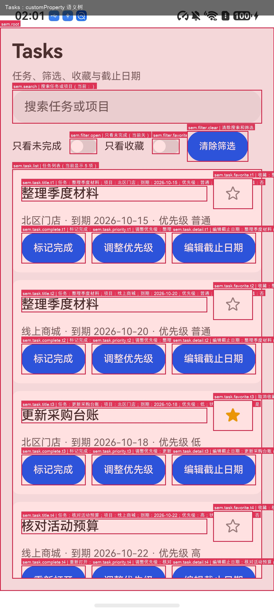
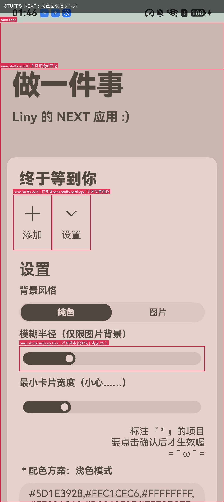
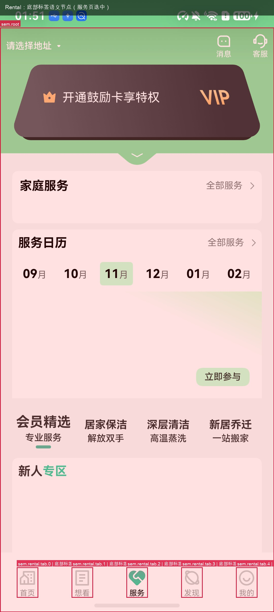

# ArkUI 语义标注与纯文本 Agent 验收报告

日期：2026-11-11  
设备：JUY-AL50，OpenHarmony 7.0.0.111 / API 26，1080 × 2406  
底座：HapTest，分支 `feat/semantic-arkui-agent`，基于 `bb3325e`  
模型：本机 magpie `auto/gpt-6-luna`，仅文本输入，不发送截图

## 一、结论

本次验收打通了一条完整的应用侧语义通路：ArkTS 源码用 `customProperty('sem', ...)` 声明结构化语义；应用运行时由 debug-only 的语义桥遍历当前挂载的 `FrameNode`，读取 `getCustomProperty`，通过本机 TCP 输出 JSON 快照；HapTest 读取快照，与实时控件树按 `id` 合并，纯文本模型选择动作，HapTest 用普通原生输入执行，动作后重新观察。

可复现的结果：

| 应用 | 类型 | 任务数 | 独立验证通过 | Agent 正常结束 | prompt tokens | completion tokens |
|---|---|---:|---:|---:|---:|---:|
| Tasks | 自建 ArkTS 应用 | 8 | 8/8 | 8/8 | 131,335 | 564 |
| STUFFS_NEXT | 开源应用，MIT | 4 | 4/4 | 3/4 | 67,165 | 522 |
| Rental | 开源应用，MIT | 1 | 1/1 | 1/1 | 8,529 | 50 |
| 合计 |  | 13 | 13/13 | 12/13 | 207,029 | 1,136 |

Tasks 的判分来自应用自己写入 `SEM_EVAL` hilog 的状态，宿主在 Agent 通道之外读取并比较目标任务字段与非目标字段；STUFFS_NEXT 的判分来自应用侧语义桥快照与前后截图；Rental 的判分来自标签节点的 selected 状态与截图。三类判分都不读取 Agent 的自述。

Rental（硅谷租房，MIT）完成了构建、安装和启动。它的首页房源数据依赖远端接口，离线时为空；本地底部标签栏可以正常渲染和切换。本次完成了 1 项标签切换任务，房源搜索、预订等业务流没有验证。

## 二、实现机制

### 2.1 源码声明

每个任务相关组件在普通 ArkUI 属性之外声明三类信息：

```typescript
Button(task.completed ? '重新打开' : '标记完成')
  .id(`sem.task.complete.${task.id}`)
  .accessibilityText(`任务：${task.title}；状态：${task.completed ? '已完成' : '进行中'}`)
  .accessibilityDescription('点击切换任务的完成状态')
  .customProperty('sem', Sem.safe(() => Sem.node({
    schema: 1,
    id: `sem.task.complete.${task.id}`,
    role: 'action',
    meaning: `切换任务完成状态：${task.title}`,
    entityKind: 'task',
    entityKey: `${task.id}`,
    state: { completed: task.completed, priority: task.priority },
    actions: [{ name: 'toggle_completion', input: 'tap', label: '切换完成状态' }],
    risk: 'changes_data'
  }), Sem.fallback(`sem.task.complete.${task.id}`)))
```

`SemanticSpec` 包含 `schema`、`id`、`role`、`meaning`、`entityKind`、`entityKey`、`state`、`actions`、`constraints`、`risk`。`Sem.node` 只做类型收窄，`Sem.safe` 隔离动态表达式的异常，`Sem.fallback` 在求值失败时保留最小可用节点。`id` 同时是 HapTest 解析实时控件的键，因此列表项使用业务实体键，保证页面内唯一。

`accessibilityText` 和 `accessibilityDescription` 仍保留，用于读屏、人工审查和桥不可用时的降级；它们不是主语义来源。

### 2.2 运行时语义桥

桥位于应用内，只进 debug 构建：

1. `EntryAbility` 在页面加载后调用 `SemanticBridge.start(uiContext)`。
2. 桥用 `socket.constructTCPSocketServerInstance()` 监听 `127.0.0.1:18765`，应用申请 `ohos.permission.INTERNET`。
3. 收到 `snapshot` 请求后，在 `UIContext.runScopedTask` 内从 `getFrameNodeById('sem.root')` 开始遍历：
   - `getCustomProperty('sem')` 读取结构化声明；
   - `getNodeType()`、`isVisible()`、`getId()` 读取运行时事实；
   - `getChildrenCount()` / `getChild(i)` 遍历当前挂载节点，不强制展开离屏懒加载项；
   - 有声明的节点进入结果，最近的语义祖先写入 `parentRef`。
4. 每个响应是一行 JSON，包含 `schemaVersion`、`revision`、`visible`、`nodes`。`revision` 只在节点内容变化时推进；同一界面的重复快照不会制造假变化。
5. 支持 `ping` 和 `prepare`。`prepare` 重新取快照并确认目标仍存在，过期引用返回 `STALE_REFERENCE`。桥不提供点击、输入、业务回调或数据库写入。

宿主通过 `hdc fport` 把本地端口转发到设备 `18765`，由 `SemanticBridgeClient` 读取。宿主动作仍走 HapTest 的 `HarmonyDevice.tap`、`swipe`、`typeText`、`pressKey`，不经过桥。

### 2.3 HapTest 宿主与 Agent

新增在 `src/semantic/`：

- `types.ts`：快照、节点、动作和视图类型。
- `bridge_client.ts`：端口转发、JSON-lines 请求、超时和 `STALE_REFERENCE` 处理。
- `project.ts`：按 `id` 把桥快照与 HapTest 实时树合并；`validateSemanticAction` 检查目标唯一性、可见、启用、声明动作和原生能力。
- `agent.ts`：快照 → 实时观察 → 投影 → 模型决策 → 校验 → 执行 → 重观察的循环，输出 JSONL 轨迹。
- `llm.ts`：magpie OpenAI 兼容客户端，温度 0，JSON 输出，记录 prompt/completion token。
- `cli.ts`：`haptest semantic tree` 与 `haptest semantic run`。

动作执行的关键约束：

- `ref` 必须存在于最新桥快照；`prepare` 失败即拒绝。
- HapTest 实时树必须用相同 `id` 唯一命中；缺失返回 `TARGET_NOT_FOUND`，重复返回 `AMBIGUOUS_TARGET`。
- `tap` 要求实时节点 `clickable`；`input` 要求文本输入或自定义组件包装节点，并在 tap 后重新观察、确认焦点、输入后按 BACK 收起键盘；`scroll` 要求实时节点 `scrollable`。
- 观察按 `bundleName` 过滤页面，避免输入法窗口被当成前台树；`typeText` 和坐标校验也使用同一 bundle 过滤。
- 输入自定义组件包装的输入框时，允许实时类型 `__Common__` 通过前置校验，由 HapTest 的“唯一焦点输入框”检查兜底。

宿主读取 HapTest 实时树用于目标校验和动作执行。模型输入只包含桥语义节点以及按 `id` 合并的少量运行时状态（`type`、`text`、`enabled`、`clickable`、`checked`、`scrollable`、`inputable`、`visible`），不包含原始树的完整层级、布局容器、resourceId 或截图。

### 2.4 标注工具

`tools/annotator/` 是 AST + LLM 原型：

- 用 SDK 自带 TypeScript 4.9.5 的 `ScriptKind.ETS` 解析 `.ets`，收集组件调用、参数、修饰符链、源码位置和片段。
- 规则覆盖 Button、TextInput、TextArea、Search、Slider、Toggle、Checkbox、Image、SymbolGlyph 和带 `onClick` 的自定义组件；布局容器默认跳过。
- 前 8 个候选交给 `auto/gpt-6-luna` 生成结构化提案，其余由规则生成。
- `applyProposalToText` 在组件调用后插入 `.id` 和 `.customProperty('sem', Sem.node(...))`，并补 `Sem` import；带尾随子组件块的容器会被标记为需要人工处理。
- `selftest.js` 在 fixture 上验证扫描、提案和插入，输出 `ANNOTATOR_SELFTEST_OK candidates=6`。

实际扫描与提案结果：

| 项目 | 文件数 | AST 候选 | LLM 提案 | 报告 |
|---|---:|---:|---:|---|
| Tasks | 7 | 30 | 4 | `evaluation/annotations/semantic-tasks/proposals.json` |
| STUFFS_NEXT | 7 | 165 | 3 | `evaluation/annotations/stuffs/proposals.json` |

Tasks 的 LLM 提案覆盖任务标题、收藏切换、任务详情和完成切换；STUFFS_NEXT 的提案覆盖页面入口标题、副标题和主瀑布流。最终应用中的标注经过人工审查和补全；带尾随块的容器和自定义组件由人工确认，工具没有声称全自动覆盖。

### 2.5 标注边界与当前实现复核

标注只允许增加隐藏信息，不改变应用原有 UI 与逻辑。允许的改动是 `.id`、`.accessibilityText`、`.accessibilityDescription` 和 `.customProperty('sem', ...)`；不允许新增 `onClick`、`@State`、可见性、尺寸、文本或新的可见节点。发布前应做前后截图 diff（排除状态栏时间）和控件树 diff：只增加属性，不增加可见节点或行为。

当前实现的复核：

| 位置 | 当前情况 | 判定 | 下一版处理 |
|---|---|---|---|
| 自建应用可见标题 | 已改为 `Text('Tasks')`，启动器名称为 `Tasks` | 前端是普通任务应用标题，不出现 semantic 字样；已用新截图替换证据 | 已完成 |
| Rental 底部标签 | 已移除额外的 `onClick`；tab 节点声明 `passthrough: true`，宿主按 bounds 执行原生 tap，切换仍由原 `Tabs.onChange` 完成 | 应用无新增 handler；已重测 1/1，2 步通过 | 已完成；`passthrough` 只适用于声明了原生 tab 手势的节点 |
| STUFFS_NEXT 汇总节点 | 新增 `Text('')`，`.visibility(Visibility.None)` | 隐藏、零布局；但新增了一个隐藏节点 | 保留前做截图/树 diff；更严格时改为 host 侧从已有卡片节点聚合，不新增节点 |
| 证据截图红框 | `render_annotated.py` 在截图上叠加 id 与红框 | 不是应用运行时 UI；应用本身不渲染这些标签 | 页面和报告明确标注“证据叠加层”；hero 使用无叠加截图 |
| STUFFS_NEXT / Rental 其余 UI | 只增加 id、customProperty、无障碍文本；未发现可见文本或布局变化 | 需要通过逐 app 的 screenshot diff 作为发布门槛 | 在 10 应用基准中把零 UI diff 作为准入条件 |

严格修正已完成：自建应用标题改为 `Tasks`，Rental 移除了额外的 `onClick` 并通过 `passthrough` 重测 1/1；STUFFS 的隐藏汇总节点仍是 `Visibility.None`，需要在 10 应用基准中通过截图/控件树 diff 验证。13 项任务已在统一修复后的宿主上重跑，状态由应用侧日志或快照独立验证。

### 2.6 状态读取与续存

语义节点的 `state` 不是静态快照。`customProperty('sem', ...)` 在组件构建时读取当前 `@State`/数据；点击后由应用自己的回调修改状态，组件重渲染后自定义属性重新求值；桥每次 `snapshot` 遍历当前 `FrameNode`，`revision` 随内容变化推进，`prepare` 在动作前重新确认目标。Agent 不维护独立状态库，也不直接写应用状态；模型下一步只读取最新视图。权威状态在应用侧，评测读取 `SEM_EVAL`、桥快照或数据库，不读取 Agent 摘要。

补充测试使用同一组“初始 → 任务后同会话 → 强制停止并重启”的流程，结果如下：

| 应用 | 初始 | 任务后（同一会话） | 重启后 | 结论 |
|---|---|---|---|---|
| 自建应用 | `t1.favorite=false` | `t1.favorite=true` | `t1.favorite=false` | 会话内更新；内存 `@State`，重启回种子 |
| STUFFS_NEXT | `cards.summary.value=0` | `value=1, extra=阅读` | `value=1, extra=阅读` | 会话内更新；KVStore 持久化 |
| Rental | `tab.0.selected=true` | `tab.2.selected=true` | `tab.0.selected=true` | 会话内更新；`@State` tab index，重启回首页 |

三次状态测试任务分别为 2、5、2 步，均成功；它们使用单独运行，不计入原 13 项任务，模型和 token 数也不并入原统计。证据在 `evaluation/state-persistence/`，包含每个应用的 `before.json`、`after.json`、`restart.json` 和复现说明。

结论分两层：同一会话内，点击后的下一次语义快照已经反映修改后的状态；跨重启是否保留，取决于应用自己的存储。自建应用使用内存状态，重启回种子；STUFFS_NEXT 使用 KVStore，卡片保留；Rental 使用 `@State` tab index，重启回首页。评测脚本在任务前 reset/clear，因此下一项任务从已知初始态开始，而不是继承上一项修改后的状态；这是可复现性要求，不是状态丢失。

### 2.7 动作后的快照收敛

桥读取的是当前挂载的 `FrameNode` 树，因此动作刚执行完就取快照，可能仍拿到动作前的内容。实测中 Rental 的标签点击已经生效，但下一次快照的 `revision` 没有推进，模型据此判断“切换失败”并提前结束。

修复在宿主侧：`SemanticAgent` 记录动作发生时的 `revision`，下一步取快照时若 `revision` 未变，就等待并重新读取，最多 5 次、每次间隔 250ms，直到内容变化或次数用尽。等待只影响读取时机，不改变动作、不写应用状态。单测 `waits for the semantic snapshot to settle before the next decision` 固定了这条不变量：第二次决策必须看到动作后的 revision。

修复后 Rental 从“3 步含一次重复 tap”变为干净的 2 步；13 项任务全部在同一宿主版本上重跑，本报告的数据来自这批统一运行。

## 三、验证应用与任务

### 3.1 Tasks（自建应用）

应用位于 `semantic-arkui-haptest/examples/semantic-tasks-app`，包含任务列表、重复标题、项目、到期日期、优先级、收藏、完成、搜索、两个筛选开关、详情面板中的截止日期输入和保存。每次状态变化写入 `SEM_EVAL` hilog。

| # | 任务 | 步骤 | prompt / completion | 验证 |
|---|---|---:|---|---|
| 1 | 收藏“整理季度材料”（北区门店） | 2 | 14,239 / 50 | 通过，t1.favorite=true |
| 2 | 取消收藏“更新采购台账” | 2 | 14,227 / 48 | 通过，t3.favorite=false |
| 3 | 标记“整理季度材料”（北区门店）已完成 | 2 | 14,244 / 62 | 通过，t1.completed=true |
| 4 | 重新打开“核对活动预算” | 2 | 14,236 / 51 | 通过，t4.completed=false |
| 5 | 在搜索框输入“采购” | 2 | 12,008 / 59 | 通过，query 包含“采购” |
| 6 | 打开“只看收藏”筛选 | 2 | 12,009 / 60 | 通过，onlyFavorite=true |
| 7 | 把“更新采购台账”的截止日期改为 2026-11-20 | 5 | 36,123 / 153 | 通过，t3.dueDate=2026-11-20 |
| 8 | 把“整理季度材料”（北区门店）的优先级调整为高 | 2 | 14,249 / 81 | 通过，t1.priority=高 |

8 项任务全部由 Agent 正常结束；判分读取应用侧 `SEM_EVAL`，并对非目标任务和未授权字段做变更检查。



### 3.2 STUFFS_NEXT（开源，MIT）

上游：`https://github.com/awaLiny2333/STUFFS_NEXT`，验证基线 `e35b7584aba160d9cae22509c0dae8184b5b5d86`。源目录：工作区 `semantic-apps/stuffs-next`。

应用本身是单页目标管理工具，没有登录，使用本地 KVStore。接入内容：

- 在 `LinysSymbolButton` 的添加/设置按钮、设置面板的毛玻璃 `Slider`、`Button`、添加面板的名称/描述 `LinysTextArea`、添加按钮和 `WaterFlow` 上添加 `customProperty('sem', ...)`；
- 增加隐藏的 `sem.stuffs.cards.summary` 节点，暴露卡片数量和名称列表；
- 在根 `RelativeContainer` 上设置 `sem.root`；
- 在 `EntryAbility` 中启动语义桥，并申请 `ohos.permission.INTERNET`。

| # | 任务 | 步骤 | prompt / completion | 验证 |
|---|---|---:|---|---|
| 1 | 打开设置面板 | 2 | 8,870 / 39 | 通过，`sem.stuffs.settings.blur` visible=true |
| 2 | 打开设置面板，把毛玻璃半径调大 | 5 | 22,374 / 194 | 通过，快照 `state.value=51 > 25`；Agent 被重复动作保护停止，未自行 finish |
| 3 | 打开添加面板 | 2 | 8,905 / 58 | 通过，`sem.stuffs.add.name` visible=true |
| 4 | 打开添加面板，输入“阅读”，向下滚动，点击添加 | 6 | 27,016 / 231 | 通过，`sem.stuffs.cards.summary` 的 value=1、extra 包含“阅读” |

第 4 项是完整的多步任务：打开条件面板、在自定义组件包装的输入框中输入中文、收起键盘、滚动 `WaterFlow` 露出被遮挡的添加按钮、点击添加、应用把卡片写入本地存储。第 3 步滚动第一次因坐标观察过期被拒绝，Agent 重新观察后第二次成功。



### 3.3 Rental（开源，MIT）：构建、启动与本地标签验证

上游：`https://github.com/yongoe1024/Rental`，验证基线 `8c6eb31b4d04411b1247b762e33b806b1c61e675`。源目录：工作区 `semantic-apps/rental`。

该应用使用 `@ohos/axios` 从远端加载首页和房源数据。构建、安装和启动通过，底部“首页/想看/服务/发现/我的”结构可见。当前测试环境的首页横幅和房源推荐为空；服务页渲染出会员、家庭服务、服务日历等内容。

改造内容：在 `Tabs` 上设置 `sem.root`，给底部标签栏的五个 `Column` 添加 `id`、`customProperty` 和 `passthrough: true`，用 `selected` 状态暴露当前标签；在 `EntryAbility` 中启动语义桥。没有新增 `onClick`；切换仍由原 `Tabs.onChange` 完成。`passthrough` 只让宿主按节点 bounds 执行原生 tap，不改变应用行为。房源业务逻辑、网络请求和页面路由没有改动。

| # | 任务 | 步骤 | prompt / completion | 验证 |
|---|---|---:|---|---|
| 1 | 切换到服务页 | 2 | 8,529 / 50 | 通过，`sem.rental.tab.2.selected=true`；服务页同时渲染 |



Rental 的 2 步轨迹干净：一次 tap 后 `revision` 推进到 2，`selected=true`，模型随即结束。`passthrough` 只把已声明的 tab 节点交给宿主按 bounds 执行原生 tap，应用没有新增 `onClick`，见 2.5。

### 3.4 其他候选

`banggx/account_app_harmonyos`（Apache-2.0，135★）是 API 9 项目，换到当前工具链后出现 116 个 ArkTS 严格模式编译错误；没有为它继续修改。`OHOTP/ohtotptoken`、`Jingmo` 等候选未在本次时间窗内完成构建和桥接入。

## 四、结果汇总

| 项目 | 数值 |
|---|---:|
| 完成任务数 | 13 |
| 独立验证通过 | 13 |
| Agent 正常结束 | 12 |
| 总步数 | 36（平均 2.77） |
| 总 prompt tokens | 207,029 |
| 总 completion tokens | 1,136 |
| 模型输入中的截图 | 0 |
| 模型输入中的原始无障碍树全文 | 0（仅按节点合并少量运行时状态） |

13 项任务只运行一次，不构成统计显著的效能实验。token 数来自模型响应的 usage 字段，包含系统提示、语义树和历史，不包含截图或原生树。单次运行中，Tasks 的截止日期任务用了 5 步、prompt token 最高；STUFFS 的毛玻璃任务在目标状态已经达成后仍多点了一次，被重复动作保护停止，独立快照仍判定通过；Rental 的标签任务 2 步完成。

## 五、证据索引

标注截图与运行证据位于本仓库 `evaluation/`：

- 标注截图：`evidence/self-annotated.jpeg`、`evidence/stuffs-annotated.jpeg`、`evidence/rental-annotated.jpeg`。
- 汇总：`evidence/self-summary.json`、`evidence/stuffs-summary.json`、`evidence/rental-summary.json`。
- 任务前后截图：`evidence/self-favorite-after.jpeg`、`evidence/self-search-after.jpeg`、`evidence/self-due-date-after.jpeg`、`evidence/stuffs-settings-after.jpeg`、`evidence/stuffs-blur-after.jpeg`、`evidence/stuffs-add-card-after.jpeg`、`evidence/rental-tab-after.jpeg`。
- 轨迹：`evidence/self-favorite-trajectory.jsonl`、`evidence/stuffs-add-card-trajectory.jsonl`、`evidence/rental-tab-trajectory.jsonl`；关键轨迹已复制到 `evidence/`，完整运行目录在本地 `evaluation/runs/`，未随公开仓库分发。
- 桥快照：`evidence/self-snapshot.json`、`evidence/stuffs-snapshot.json`、`evidence/rental-snapshot.json`。
- 标注扫描/提案：`annotations/semantic-tasks/proposals.json`、`annotations/stuffs/scan.json`、`annotations/stuffs/proposals.json`。
- 标注工具自测：`evidence/annotator-selftest.txt`。
- 状态续存测试：`evaluation/state-persistence/` 下的 `before.json`、`after.json`、`restart.json` 与复现说明。
- HapTest 提交记录：`evidence/haptest-commits.txt`。公开仓库从清理后的快照开始，该文件记录本地开发分支的提交信息。

源码位置：

- 自建应用：`examples/semantic-tasks-app`
- STUFFS 改造：第三方源码，未随仓库分发；上游链接与验证基线见 `THIRD-PARTY.md`。
- Rental 改造：第三方源码，未随仓库分发；上游链接与验证基线见 `THIRD-PARTY.md`。
- HapTest 宿主与语义层：`src/semantic/`
- 语义桥模板：`examples/semantic-tasks-app/entry/src/main/ets/semantics/`

## 六、限制

1. **第二个开源应用只验证了本地标签切换。** STUFFS_NEXT 完成了 4 项多步任务；Rental 完成了 1 项底部标签切换，首页/房源搜索/预订等远端业务流程没有验证；记账应用受旧 API 9 编译问题阻塞。下一轮应选择一个数据本地化、可重置的第二个开源应用，完成与 STUFFS_NEXT 同等规模的任务集。
2. **桥只在 debug 构建中启用。** 本次没有验证 release 包隔离、签名发布和桥代码裁剪；生产化需要单独的构建开关和发布检查。
3. **STUFFS 的验证强度低于自建应用。** 自建应用有 Agent 通道之外的 `SEM_EVAL` 状态日志；STUFFS 使用应用侧桥快照和截图，没有独立数据库或日志 oracle。第 4 项任务的“卡片已添加”由 `cards.summary` 快照确认，不是由外部数据源确认。
4. **语义覆盖是局部的。** 只覆盖任务相关页面和常见组件；STUFFS 的自定义组件、设置面板剩余控件、卡片列表行没有全部标注；标注工具对带尾随子组件块的容器只给出人工处理提示。
5. **Agent 的结束策略仍需改进。** 毛玻璃任务在目标状态已达到后重复点击，被重复动作保护停止；结果是任务状态正确但 Agent 没有自行 finish。当前验收以独立状态快照为准，不把 Agent 的 finish 等同于任务成功。
6. **运行次数有限。** 每个任务只运行一次，没有多种子、重复运行或对照条件；本报告不提供统计显著性结论。
7. **模型摘要可能与实际动作不一致。** 个别任务的自然语言摘要把“动作后的最终状态”说成“无需操作”，实际动作和状态变化以轨迹、快照和日志为准。

## 七、复现

环境：

把 `<device-serial>` 替换为 `$HDC list targets` 显示的设备序列号。

```sh
export HDC=/Applications/DevEco-Studio.app/Contents/sdk/default/openharmony/toolchains/hdc
export DEVECO_SDK_HOME=/Applications/DevEco-Studio.app/Contents/sdk
export OHOS_BASE_SDK_HOME=/Applications/DevEco-Studio.app/Contents/sdk/default/openharmony
$HDC list targets   # <device-serial>
```

HapTest：

```sh
cd <repo>
NODE_ENV=development npm install --include=dev
npm run build
npm test -- --run
HAPTEST_E2E_SERIAL=<device-serial> npm run e2e
```

自建应用：

```sh
cd examples/semantic-tasks-app
/Applications/DevEco-Studio.app/Contents/tools/hvigor/bin/hvigorw assembleHap --mode module -p product=default
$HDC uninstall org.anapp.research.prototype || true
$HDC install entry/build/default/outputs/default/entry-default-signed.hap
cd ../..
python3 evaluation/run_self_eval.py --serial <device-serial>
```

STUFFS_NEXT 与 Rental 的源码不随仓库分发；将 `<third-party-apps>` 替换为本地源码树。

STUFFS：

```sh
cd <third-party-apps>/stuffs-next
/Applications/DevEco-Studio.app/Contents/tools/hvigor/bin/hvigorw assembleHap --mode module -p product=default
$HDC uninstall org.anapp.research.prototype || true
$HDC install entry/build/default/outputs/default/entry-default-signed.hap
cd <repo>
python3 evaluation/run_stuffs_eval.py --serial <device-serial>
```

Rental：

```sh
cd <third-party-apps>/rental
/Applications/DevEco-Studio.app/Contents/tools/hvigor/bin/hvigorw assembleHap --mode module -p product=default
$HDC uninstall org.anapp.research.prototype || true
$HDC install entry/build/default/outputs/default/entry-default-signed.hap
cd <repo>
python3 evaluation/run_rental_eval.py --serial <device-serial>
```

语义树与单任务：

```sh
node bin/haptest semantic tree --serial <device-serial> --out /tmp/tree.json
node bin/haptest semantic run --serial <device-serial> \
  --bundle org.anapp.research.prototype \
  --task "打开设置面板，把毛玻璃半径调大" \
  --out /tmp/run
```

标注工具：

```sh
node tools/annotator/selftest.js
node tools/annotator/cli.js scan --project ../semantic-apps/stuffs-next --out /tmp/scan.json
node tools/annotator/cli.js propose --project ../semantic-apps/stuffs-next --out /tmp/proposals.json --llm-limit 8
```

## 八、下一阶段实验设计

当前 3 个应用、13 个任务是机制 pilot。下一步建议做 **ArkUI-AgentBench（暂名）：10 个应用 × 4 个任务 = 40 个任务**，先以 5 个应用、20 个任务验证管线，再扩到 10 个应用。它足以覆盖列表、表单、标签、滑块、弹窗、滚动、自定义组件和重复标题等差异，但仍不足以做统计显著的论文结论；论文级通常需要 20+ 应用、100+ 任务、多模型和 3 个以上 seed。

### 8.1 同类论文的基准与数据

| 基准/数据 | 平台 | 规模 | 说明 |
|---|---|---:|---|
| AndroidWorld | Android | 116 tasks / 20 apps | 可复现交互环境，动态任务 |
| AndroidLab | Android | 138 tasks / 9 apps | 训练与系统评测；PhoneCLI 使用 |
| Android in the Wild | Android | 715k episodes / 30k instructions | 人类演示数据，不是交互环境 |
| GUI-Odyssey | Android | 大规模跨应用轨迹 | 训练/评测数据 |
| ScreenSpot | 跨平台 | 元素定位指令 | grounding，不是完整任务 |
| Mind2Web / WebArena / OSWorld | Web / 桌面 | 非移动 | 对应领域基准，不可直接迁移 |

鸿蒙目前没有一个像 AndroidWorld/AndroidLab 那样被广泛采用的 GUI-Agent 任务基准；现有鸿蒙资料更多是 UITest、兼容性或自动化测试。当前 3 个应用是 pilot，10 个应用的任务集需要自己收集、标注和固定重置协议。应用筛选标准：API 26 可构建、本地数据、无登录/支付/强网络依赖、许可证允许分发任务补丁、任务相关控件本身已有可点击/可输入行为；不接受为了任务而新增 `onClick` 的应用。

### 8.2 任务、基线与指标

- **应用组成**：自建 Tasks 1 个 + 当前 STUFFS_NEXT、Rental 2 个 + 新收集 7 个；每个应用 4 个任务，覆盖状态切换、表单输入、筛选/导航、多步操作各至少一项。
- **标注边界**：只允许隐藏属性；零 UI diff；隐藏调试节点必须零布局；逐 app 的截图/控件树 diff 通过后才纳入。
- **独立 oracle**：自建应用写 `SEM_EVAL`；第三方优先使用应用数据库、文件或日志；桥快照作为补充，不把 Agent 摘要当作判分。
- **基线**：截图 + 多模态模型；原始 uitest/无障碍树 + 纯文本模型；语义树 + 纯文本模型。消融：去掉 state、去掉 actions、去掉 live 校验、去掉 `prepare`；手工标注 vs AST+LLM 提案 + 人工复核。
- **指标**：独立验证成功率、Agent 自行结束率、步数、prompt/completion tokens、端到端时延、无效/过期动作率、恢复率、标注时间与覆盖率、零 UI diff 通过率、状态续存正确率。每个任务运行 2–3 次，固定设备与模型。
- **状态子研究**：把“同一会话内更新”和“重启后持久化”分开统计；每个应用记录 `session-only / persisted / reset`，并在任务定义中写清 reset 语义。
- **发布**：任务 JSON、标注补丁、reset 脚本、运行日志、before/after 截图、独立 oracle 和报告；第三方应用不整包分发，保留上游链接、提交基线和许可证。

10 个应用是合理的下一步规模，但不是论文级规模。先完成 5 个应用/20 个任务的 pilot，验证零 UI diff、状态 oracle 和标注成本，再扩到 10 个/40 个；若结果支持，再增加到 20+ 应用、100+ 任务。

## 九、提交

HapTest 分支 `feat/semantic-arkui-agent`：

- `46ee01f` docs(semantic): add design and fix E2E re-observe before key action
- `4fb3257` test(e2e): wait for foreground after app launch
- `d7807d6` feat(semantic): add Sem helper, customProperty bridge, and passing device probe
- `d6fe529` chore: ignore local node_modules symlink
- `b05672e` feat(semantic): add bridge client, projection, action validation, text-only agent, and CLI
- `14f3f74` feat(semantic): add annotated SemanticTasks app with search, filters, favorites, and due-date editing
- `c87f363` feat(semantic): select the app window by bundle and re-observe before text input
- `238741d` feat(semantic): add annotator prototype, STUFFS validation, and visibility/input fixes
- `53d542c` docs(semantic): add acceptance report and evidence
- `3ae5819` chore(semantic): add annotated screenshot renderer
- `7c58c5e` feat(semantic): validate Rental tab semantics and update acceptance report

后续文档提交见分支末尾。

上游基线：HapTest `bb3325e`；STUFFS_NEXT `e35b7584`；Rental `8c6eb31b`；account_app `b27fde23`。

